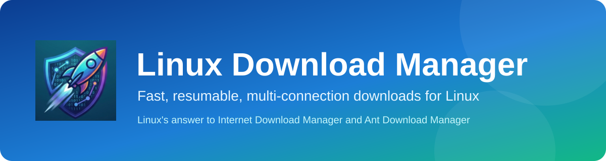
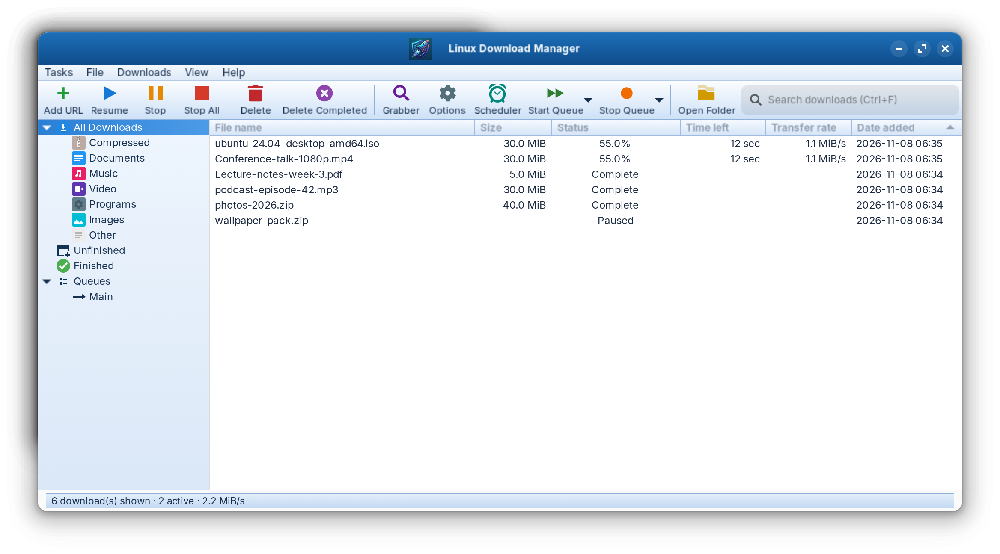
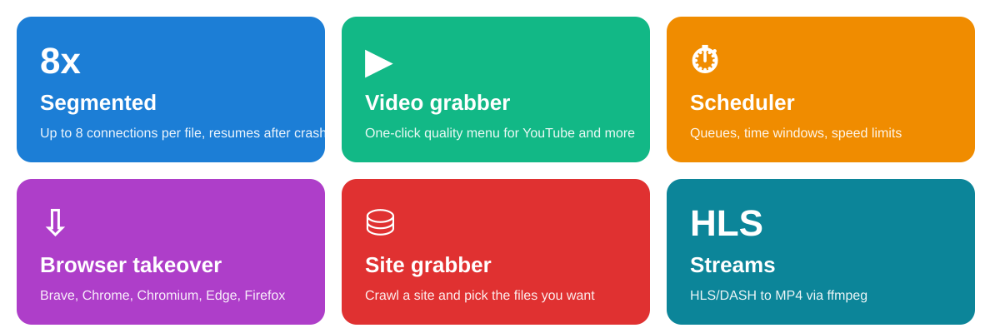
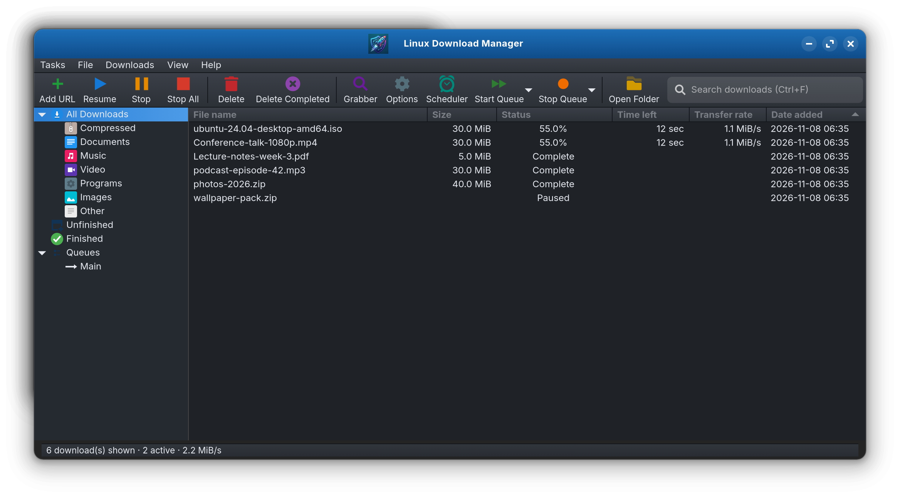
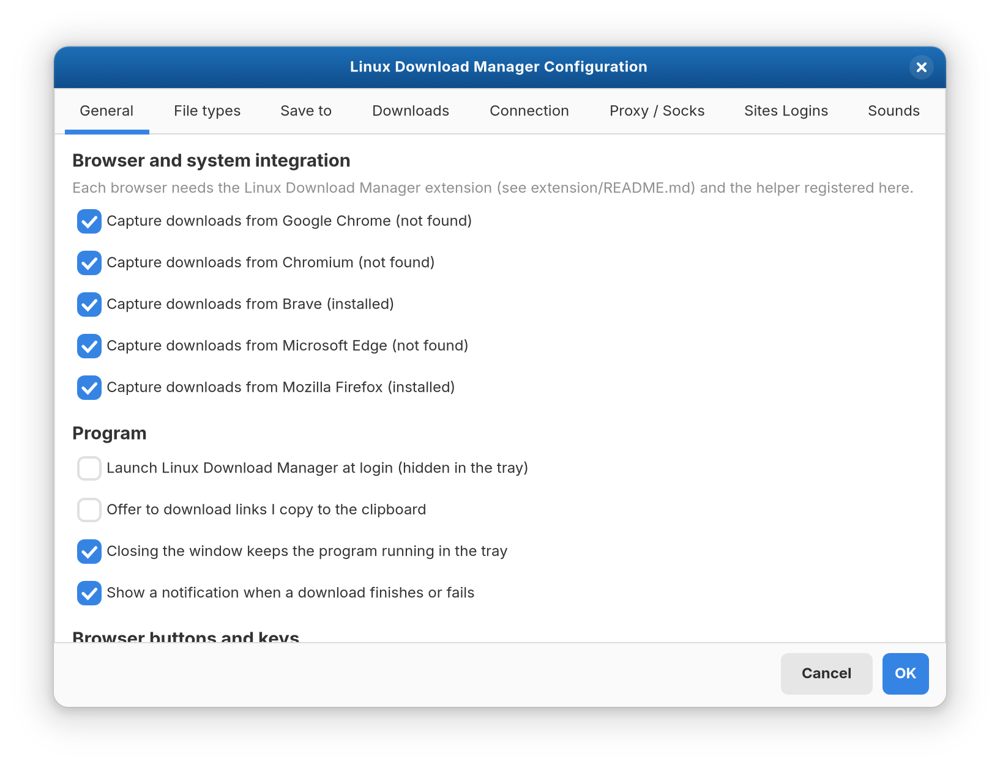
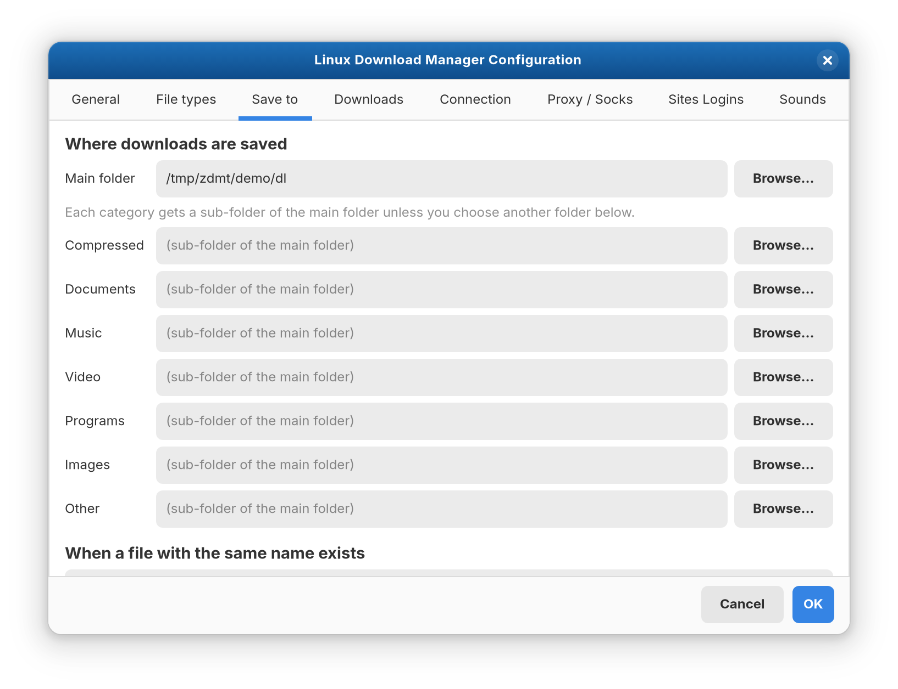
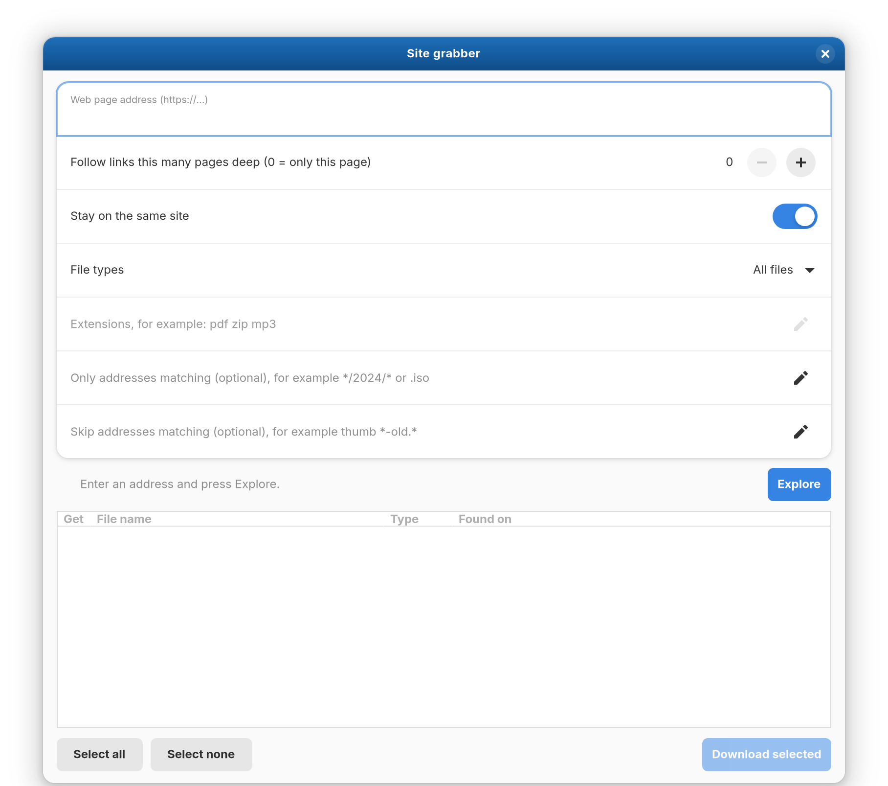
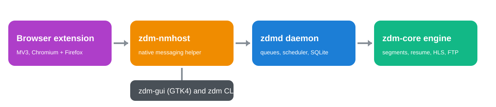

<p align="center"></p>

<p align="center">
  
  
  
  
  
</p>

<h3 align="center">Linux's answer to Internet Download Manager and Ant Download Manager,<br>which only run on Windows.</h3>

<p align="center"></p>

## Why

Download managers such as Internet Download Manager and Ant Download Manager are popular, but they only work on Windows. **Linux Download Manager (LDM)** brings the same kind of experience to Linux: a colourful desktop window, browser takeover, a one-click video button, queues and a scheduler.

## Features

<p align="center"></p>

- **Faster downloads**: files are split into up to 8 parts fetched in parallel, with automatic retries.
- **Resume**: stop, crash or reboot and carry on where you left off (only the missing parts are requested again).
- **Browser integration**: clicking a download link in your browser hands it to LDM.
- **Video button**: a *Download this video* button appears on video pages with a menu of qualities (uses yt-dlp).
- **Queues and scheduler**: weekly time windows, parallel limits, per-queue and global speed limits, an action when everything finishes (sleep, shut down or run a command).
- **Site grabber**: crawl a website and choose which files to fetch, with include and exclude patterns.
- **Streams**: HLS (including AES-128) and DASH are downloaded and merged to MP4 with ffmpeg.
- **Protocols**: HTTP, HTTPS and FTP; proxy (HTTP and SOCKS5), Basic and Digest login, cookies.
- **Tidy**: categories (Compressed, Documents, Music, Video, Programs, Images), duplicate handling, saved site logins, sounds, notifications, tray icon, dark mode.
- **CLI** for scripting: `zdm add`, `zdm list` and more.

## Screenshots

| Dark mode | Options |
|---|---|
|  |  |
| **Save to** | **Site grabber** |
|  |  |

## Supported systems

| | Status |
|---|---|
| **OS** | Zorin OS 18 (Ubuntu 24.04 base, GNOME) is the tested system. Ubuntu 24.04 and newer, and other distributions with the libraries below, should work but are untested. |
| **Architecture** | **x86_64 / amd64** only. The release is built for amd64; ARM (arm64) is not provided. |
| **Libraries** | GTK 4.14 or newer, libadwaita 1.5 or newer, glibc |
| **Optional tools** | `ffmpeg` (streams, merging video and audio) and `yt-dlp` (YouTube and other video sites) |

### Browsers

| Browser | Status |
|---|---|
| Brave (deb) | Verified |
| Firefox (Mozilla deb/apt build) | Verified |
| Google Chrome, Chromium (deb), Microsoft Edge | Same extension code as Brave; not tested |
| Firefox **snap**, and any snap or Flatpak browser | Not supported (sandbox blocks the helper) |

## Install

### Option 1: the `.deb` package (recommended)

Download `linux-download-manager_0.1.0_amd64.deb` from the [Releases page](../../releases), then:

```bash
sudo apt install ./linux-download-manager_0.1.0_amd64.deb
```

Optional but recommended (video sites and streams):

```bash
sudo apt install ffmpeg
python3 -m pip install --user -U yt-dlp
```

### Option 2: build from source

```bash
sudo apt install build-essential pkg-config libgtk-4-dev libadwaita-1-dev
curl https://sh.rustup.rs -sSf | sh
cargo build --release
./packaging/install-user.sh      # adds the launcher and icon for your user
```

## Connect your browser

1. Start LDM once (menu: *Linux Download Manager*). **Options > General** (Browser and system integration) shows which browsers were found.
2. Tick your browser and press OK: this registers the helper that lets the browser talk to LDM.
3. Install the extension:
   - **Chrome, Brave, Chromium, Edge**: open `chrome://extensions`, switch on *Developer mode*, choose *Load unpacked*, and select `chrome/` from the extension zip in the release (or `/usr/share/linux-download-manager/chrome` when installed from the `.deb`).
   - **Firefox**: open `about:debugging`, *This Firefox*, *Load Temporary Add-on*, and select `manifest.json` inside the `firefox/` folder. (Temporary add-ons are removed when Firefox closes; there is no store release yet.)
4. Click a download link. LDM takes over. Hold a modifier key (set in the extension popup) to let the browser download instead.

## How to use

1. **Add URL**: paste a link and press OK. Choose the folder, queue and login if needed.
2. **Watch progress**: double-click a row for the detailed window with the connection map.
3. **Stop / Resume / Delete**: toolbar buttons or right-click.
4. **Video pages**: open a video, hover it and press *Download this video*, then pick a quality.
5. **Grabber**: *Grabber* in the toolbar crawls a page for files.
6. **Scheduler**: *Scheduler* sets start and stop times and what happens when downloads finish.
7. **Options**: tabs for general and browser setup, file types, folders, downloads, connection, proxy, site logins and sounds.

### Command line

```bash
zdm add https://example.com/big.iso     # queue a download
zdm list                                # show everything
zdm pause 3 ; zdm resume 3              # control by id
zdm get https://example.com/file.zip    # one-off download without the daemon
```

## Architecture

<p align="center"></p>

Rust workspace: `zdm-core` (engine), `zdm-proto` (JSON-lines protocol over a private unix socket), `zdmd` (daemon), `zdm-cli`, `zdm-gui` (GTK4), `zdm-nmhost` (browser helper), plus the `extension/` folder.

## Troubleshooting

- **YouTube says "Sign in to confirm you're not a bot"**: YouTube is limiting your connection. Wait a while, or choose your browser under *Options > Downloads* so yt-dlp can use its sign-in.
- **Video menu errors**: update yt-dlp with `yt-dlp -U` (or `pip install --user -U yt-dlp`).
- **Clicks in Firefox are not taken over**: snap Firefox is not supported; use the Mozilla deb build or Brave.
- **No tray icon on GNOME**: install the AppIndicator extension.

## Known limits

NTLM login, FTPS and live streams are not supported. The browser extension is not published in any store. The systemd user unit in `packaging/systemd` is untested, and the `.deb` has not been test-installed on a clean machine.

## Privacy and security

LDM talks only to the sites you download from. The daemon socket and database are readable only by your user. Browser cookies are sent only for the download you start, through a private temporary file. Please download only content you have the right to download and respect each site's terms.

## Contributors

<table><tr><td align="center"><a href="https://github.com/bharadfi"><b>bharadfi</b></a><br>Author and maintainer</td></tr></table>

## Credits

Built with [Rust](https://www.rust-lang.org), [GTK4](https://gtk.org) and [libadwaita](https://gnome.pages.gitlab.gnome.org/libadwaita/), with [yt-dlp](https://github.com/yt-dlp/yt-dlp) and [FFmpeg](https://ffmpeg.org) for video.

## License

Dual-licensed under [MIT](LICENSE-MIT) or [Apache-2.0](LICENSE-APACHE), at your option.
